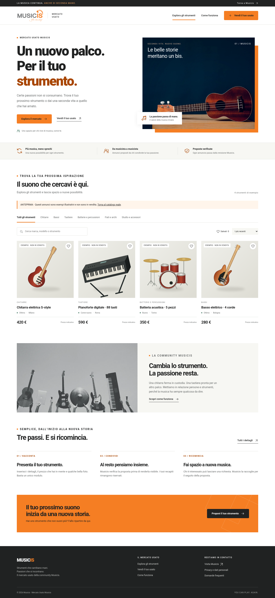

# Musicis · Progetti web

## Mercato-Usato-Musicis

Sito per il mercato degli strumenti musicali usati Musicis: catalogo, pagina “Come funziona”, modulo di proposta con caricamento foto e gestione riservata degli annunci.

**[Apri il progetto](Mercato-Usato-Musicis/)** · **[Guida completa](Mercato-Usato-Musicis/README.md)**

Il frontend utilizza HTML, CSS e JavaScript; il servizio Node.js salva annunci e immagini e gestisce la moderazione con SQLite. Il caricamento del codice su GitHub non attiva il sito su musicis.it.

### Avvio

Richiede Node.js 24 LTS (minimo 22.13).

```bash
cd Mercato-Usato-Musicis
npm ci --no-fund
npm test
npm start
```

Il servizio usa la porta 3000 e il percorso `/mercato-usato/`. Per l’area riservata configurare una password personale seguendo `.env.example`. Prima del lancio pubblico completare l’informativa privacy e verificare l’hosting; le istruzioni sono nella guida del progetto.

### Anteprima grafica

Gli annunci dell’anteprima sono esempi illustrativi, non offerte reali.



[Visualizza il modulo di vendita](Mercato-Usato-Musicis/docs/anteprima-modulo.png)

### Verifiche

Il progetto include test per upload, riservatezza, moderazione, richieste e cancellazione; è disponibile anche una prova automatizzata nel browser. Database, credenziali, dipendenze installate e foto inviate dagli utenti sono esclusi dal repository.
